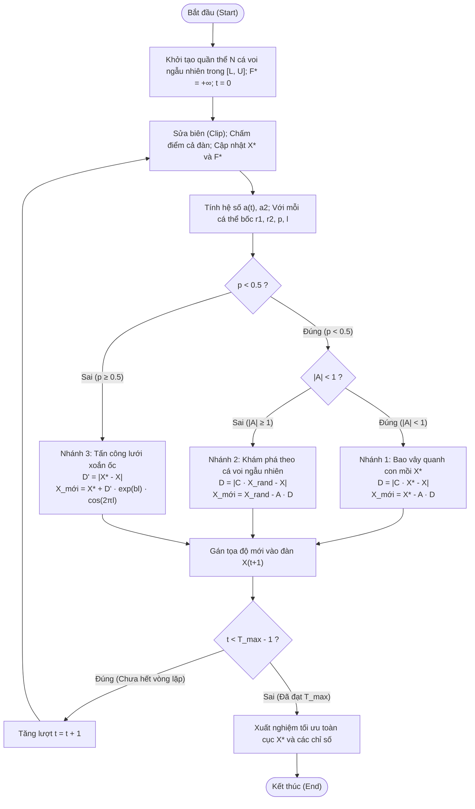

# KỊCH BẢN NỘI DUNG VÀ TRÌNH BÀY SLIDE SEMINAR: THUẬT TOÁN TỐI ƯU HÓA BẦY CÁ VOI (WOA)

> **Môn học / Chuyên đề**: Thuật toán Tối ưu hóa & Metaheuristics  
> **Đề tài ứng dụng**: Quy hoạch quỹ đạo bay UAV và phân bổ túi năng lượng cứu hộ ("Đom Đóm")  
> **Tài liệu đối chiếu**: Giáo trình LaTeX nhóm (*WOA · Từ công thức đến bài demo Đom Đóm*) & Báo cáo chuyên đề Nhóm 4  
> **Thời lượng báo cáo**: 20 – 25 phút

---

# PHẦN I: KHÁI NIỆM & NGUỒN GỐC THUẬT TOÁN (SLIDE 1 – 4)

## SLIDE 1: TRANG TIÊU ĐỀ
* **Tiêu đề chính**: THUẬT TOÁN TỐI ƯU HÓA BẦY CÁ VOI (WHALE OPTIMIZATION ALGORITHM - WOA)
* **Tiêu đề phụ**: Từ nền tảng lý thuyết toán học đến ứng dụng quy hoạch đường bay UAV cứu hộ ("Đom Đóm")
* **Nhóm thực hiện**: Nhóm 4
* **Cấu trúc bài trình bày (Bố cục 6 phần)**:
  1. *Khái niệm & Bối cảnh ra đời*
  2. *Mô tả thuật toán toán học*
  3. *Sơ đồ khối quy trình*
  4. *Ví dụ áp dụng: Bài toán UAV Đom Đóm*
  5. *Demo thực nghiệm (Quy trình 6 mốc & So sánh 3 ca)*
  6. *Khai thác bốn ngách cải tiến & Đánh giá thuật toán*

---

## SLIDE 2: BỐI CẢNH RA ĐỜI & TÁC GIẢ WOA
### 1. Bối cảnh & Nhu cầu thực tiễn
* Trong thực tế, các bài toán tối ưu kỹ thuật (tìm hình dạng kết cấu nhẹ nhất chịu tải lớn, lộ trình giao hàng ngắn nhất, phân bổ năng lượng) thường có đặc điểm: **phi tuyến tính, phi lồi, nhiều ràng buộc đan xen và chứa vô số cực trị cục bộ**.
* Các phương pháp giải tích cổ điển (dựa vào đạo hàm, gradient descent) dễ bị bế tắc hoặc mắc kẹt tại cực trị địa phương.
* Điều này thúc đẩy sự ra đời của các thuật toán **Metaheuristic** (siêu phỏng sinh học): không cần tính đạo hàm, linh hoạt và có khả năng khám phá không gian nghiệm đa chiều rộng lớn.

### 2. Tác giả & Công trình công bố
* Thuật toán do hai nhà khoa học máy tính **Seyedali Mirjalili** và **Andrew Lewis** (thuộc Đại học Griffith, Australia) đề xuất và công bố năm **2016** trên tạp chí quốc tế uy tín *Advances in Engineering Software* (Tập 95, tr. 51–67).
* **Seyedali Mirjalili**: Chuyên gia hàng đầu thế giới về trí tuệ nhân tạo và tính toán tiến hóa, là cha đẻ của hàng loạt thuật toán nổi tiếng lấy cảm hứng từ tự nhiên như:
  * *Grey Wolf Optimizer (GWO - Tối ưu bầy sói xám)*
  * *Whale Optimization Algorithm (WOA - Tối ưu bầy cá voi)*
  * *Moth-Flame Optimization (MFO - Tối ưu bướm đêm)*
* **Andrew Lewis**: Chuyên gia kỹ thuật và tính toán thông minh tại Griffith University, đồng tác giả phát triển mô hình toán học cho WOA.

---

## SLIDE 3: CẢM HỨNG SINH HỌC & ÁNH XẠ TOÁN HỌC
### 1. Chiến thuật săn mồi bằng lưới bong bóng (*Bubble-net Feeding*)
Cá voi lưng gù (*Megaptera novaeangliae*) là loài động vật biển có tập tính xã hội và trí khôn đặc biệt. Khi săn các đàn cá nhỏ:
1. **Lặn sâu & Định vị**: Cá voi lặn sâu khoảng $12\text{m}$ xuống dưới đàn mồi.
2. **Thổi bọt khí tạo lưới xoắn ốc**: Chúng vừa bơi vòng tròn hướng dần lên mặt nước, vừa liên tục nhả các chuỗi bong bóng khí theo đường xoắn ốc (hình logarithmic hoặc hình số 9).
3. **Dồn ép con mồi**: Lưới bong bóng nổi lên tạo thành bức tường bọt khí khép kín khiến con mồi hoảng sợ, co cụm lại ở giữa.
4. **Tấn công dứt điểm**: Khi vòng xoắn siết chặt, cá voi lao thẳng từ dưới lên tâm vòng tròn để đớp trọn đàn mồi.

### 2. Bảng ánh xạ từ Tự nhiên sang Thuật toán toán học:

| Hiện tượng tự nhiên | Khái niệm trong thuật toán WOA | Bản chất toán học / Lập trình |
| :--- | :--- | :--- |
| **Một con cá voi** | Một nghiệm ứng viên trong quần thể | Vector $n$ chiều: $\vec{X}_i = (x_{i,1}, x_{i,2}, \dots, x_{i,n})$ |
| **Con mồi** | Nghiệm tốt nhất tìm thấy tính đến hiện tại | Vector kỷ lục: $\vec{X}^*$ (có điểm thích nghi $f(\vec{X}^*)$ tối ưu nhất) |
| **Bao vây con mồi** | Cơ chế Khai thác cục bộ (Exploitation) | Co cụm tọa độ $\vec{X}_i$ dần về phía $\vec{X}^*$ |
| **Bơi xoắn ốc nhả bọt** | Cập nhật vị trí theo hàm xoắn ốc logarithmic | Dịch chuyển xoay quanh $\vec{X}^*$ kết hợp hàm $\exp(bl) \cos(2\pi l)$ |
| **Đi tìm mồi ở vùng biển khác**| Cơ chế Khám phá diện rộng (Exploration) | Dịch chuyển theo một cá thể ngẫu nhiên $\vec{X}_{\text{rand}}$ trong đàn |

---

## SLIDE 4: CÁC HIỂU LẦM THƯỜNG GẶP VỀ WOA
*(Trích xuất từ các tài liệu phân tích phê bình học thuật — Wolpert & Macready, 1997; Camacho Villalón et al., 2023)*

* **Hiểu lầm 1: WOA là mô hình AI có khả năng tự học.**
  * *Hiểu đúng*: WOA là thuật toán tối ưu hóa Metaheuristic ngẫu nhiên, hoạt động dựa trên các phép cập nhật vị trí số học, không phải mạng nơ-ron hay mô hình học máy.
* **Hiểu lầm 2: Thuật toán mô phỏng toàn diện sinh học cá voi.**
  * *Hiểu đúng*: Ẩn dụ cá voi chỉ đóng vai trò gợi ý trực quan để đặt tên thuật toán. Bản chất bên trong chỉ là các công thức cập nhật tọa độ cộng trừ số ngẫu nhiên.
* **Hiểu lầm 3: "Cá voi dẫn đầu" $\vec{X}^*$ chắc chắn là nghiệm tối ưu tuyệt đối.**
  * *Hiểu đúng*: $\vec{X}^*$ chỉ là nghiệm tốt nhất mà đàn tìm được tính đến vòng lặp hiện tại, hoàn toàn có thể là cực tiểu địa phương.
* **Hiểu lầm 4: Khám phá và Khai thác diễn ra ở hai giai đoạn tách bạch.**
  * *Hiểu đúng*: Hai cơ chế này đan xen trong từng vòng lặp thông qua xác suất $p$ và hệ số $|A|$. Khi $a < 1$ (ở nửa sau cuộc tìm kiếm), nhánh khám phá ngẫu nhiên bị tắt hoàn toàn.
* **Hiểu lầm 5: WOA luôn tốt hơn các thuật toán khác (GA, PSO).**
  * *Hiểu đúng*: Theo định lý *No Free Lunch*, không có thuật toán nào vượt trội trên mọi bài toán. WOA có hiện tượng thiên lệch tâm (*Center Bias*) nên giải rất tốt các bài toán có nghiệm ở gốc tọa độ, nhưng cần kiểm chứng thực tế trên bài toán cụ thể.

---

# PHẦN II: MÔ TẢ THUẬT TOÁN TOÁN HỌC (SLIDE 5 – 7)

## SLIDE 5: KHỞI TẠO QUẦN THỂ & ĐÁNH GIÁ THÍCH NGHI
### 1. Không gian tìm kiếm & Khởi tạo
Quần thể gồm $N$ cá voi, mỗi cá thể gồm $n$ biến số. Mỗi biến thứ $j$ có miền giới hạn $[L_j, U_j]$:
$$x_{i,j}(0) = L_j + r_{i,j} \cdot (U_j - L_j), \quad r_{i,j} \sim U(0, 1)$$
* Trong dự án UAV Đom Đóm: $N = 30$ cá voi, mỗi cá voi mang $n = 30$ biến số thực.

### 2. Đánh giá Hàm thích nghi (Fitness Function) & Sổ lưu Kỷ lục
* WOA không tự biết đường bay nào đẹp. Nhóm thiết kế hàm chấm điểm $f(\vec{X})$ theo quy ước: **Điểm càng nhỏ càng tối ưu**.
* Ban đầu gán $F^* = +\infty$. Sau khi chấm điểm cả đàn ở thế hệ $t$:
$$\vec{X}^* = \arg\min_{\vec{X}_i} f(\vec{X}_i), \quad F^* = \min f(\vec{X}_i)$$
* **Lưu riêng bản sao kỷ lục**: Cá thể lập kỷ lục ở lượt sau có thể bơi sang vị trí xấu hơn. Việc lưu riêng $\vec{X}^*$ giúp đàn cá voi không bao giờ bị mất phương án tốt nhất đã gặp.

---

## SLIDE 6: CÁC THAM SỐ ĐIỀU KHIỂN & BA CƠ CHẾ DỊCH CHUYỂN
### 1. Hệ số giảm tuyến tính $a(t)$
Chuyển hóa từ Khám phá sang Khai thác qua $T_{\text{iter}}$ vòng lặp:
$$a(t) = 2 - \frac{2t}{T_{\text{iter}}}, \quad t = 0, 1, \dots, T_{\text{iter}} - 1$$
Từ $a$, bốc các số ngẫu nhiên $r_1, r_2 \sim U(0, 1)$ để tạo các vector hệ số:
$$\vec{A} = 2a \odot \vec{r}_1 - a \in [-a, a], \quad \vec{C} = 2 \odot \vec{r}_2 \in [0, 2]$$

### 2. Quy tắc rẽ nhánh (Tung đồng xu xác suất $p \sim U(0, 1)$):
$$\text{Cơ chế cập nhật} = \begin{cases} 
\text{Bao vây con mồi (Encircling)}, & p < 0.5 \text{ và } |\vec{A}| < 1 \\ 
\text{Khám phá ngẫu nhiên (Exploration)}, & p < 0.5 \text{ và } |\vec{A}| \ge 1 \\ 
\text{Tấn công lưới xoắn ốc (Spiral)}, & p \ge 0.5 
\end{cases}$$

---

## SLIDE 7: CÔNG THỨC CHI TIẾT CỦA 3 NHÁNH CẬP NHẬT
*(Lưu ý: Dấu giá trị tuyệt đối áp dụng riêng từng ô tọa độ, không phải khoảng cách Euclid gộp lại thành 1 số)*

### Nhánh 1: Bao vây con mồi ($p < 0.5$ và $|\vec{A}| < 1$)
Co cụm quanh nghiệm tốt nhất $\vec{X}^*(t)$:
$$\vec{D} = \left| \vec{C} \odot \vec{X}^*(t) - \vec{X}_i(t) \right|$$
$$\vec{X}_i(t+1) = \vec{X}^*(t) - \vec{A} \odot \vec{D}$$

### Nhánh 2: Khám phá ngẫu nhiên ($p < 0.5$ và $|\vec{A}| \ge 1$)
Bám theo một cá thể $\vec{X}_{\text{rand}}$ được chọn ngẫu nhiên trong đàn để mở rộng không gian tìm kiếm:
$$\vec{D}_{\text{rand}} = \left| \vec{C} \odot \vec{X}_{\text{rand}}(t) - \vec{X}_i(t) \right|$$
$$\vec{X}_i(t+1) = \vec{X}_{\text{rand}}(t) - \vec{A} \odot \vec{D}_{\text{rand}}$$

### Nhánh 3: Tấn công xoắn ốc ($p \ge 0.5$)
Bơi xoắn ốc logarithmic tiến về con mồi (với hằng số hình dạng $b = 1$):
$$\vec{D}' = \left| \vec{X}^*(t) - \vec{X}_i(t) \right|$$
$$\vec{X}_i(t+1) = \vec{X}^*(t) + \vec{D}' \cdot e^{bl} \cdot \cos(2\pi l)$$
* Theo mã nguồn MATLAB của Mirjalili: tham số xoắn $l$ được bốc từ $[a_2, 1]$ với $a_2 = -1 - \frac{t}{T_{\text{iter}}}$.

### Cơ chế sửa biên (Boundary Handling):
Nếu tọa độ bị văng ra ngoài không gian tìm kiếm, sử dụng kỹ thuật **Clip** kéo về mép gần nhất:
$$x_{i,j} \leftarrow \min\big(U_j, \max(L_j, x_{i,j})\big)$$

---

# PHẦN III: SƠ ĐỒ KHỐI VÀ THUYẾT MINH QUY TRÌNH (SLIDE 8)

## SLIDE 8: SƠ ĐỒ KHỐI QUY TRÌNH THUẬT TOÁN WOA



### Thuyết minh quy trình:
1. **Khởi tạo**: Tạo $N$ cá voi phân bố đều trên bản đồ, khởi tạo bộ nhớ leader $F^* = +\infty$.
2. **Đánh giá & Cập nhật Leader**: Chấm điểm thích nghi từng cá thể; nếu có cá thể vượt kỷ lục, sao chép nguyên trạng cá thể đó vào $\vec{X}^*$.
3. **Phân nhánh 2 tầng**: Đàn cá voi tự động chuyển từ thế trận bủa vây diện rộng ($|A| \ge 1$) sang siết chặt vòng vây ($|A| < 1$) và xoắn ốc ($p \ge 0.5$) khi $t$ tăng dần.
4. **Kiểm tra biên & Hậu điều kiện**: Toàn bộ đàn được kiểm tra giới hạn biến trước khi chấm điểm lượt tiếp theo.

---

# PHẦN IV: VÍ DỤ ÁP DỤNG — BÀI TOÁN UAV CỨU HỘ "ĐOM ĐÓM" (SLIDE 9 – 11)

## SLIDE 9: BỐI CẢNH & KHÔNG GIAN BÀI TOÁN "ĐOM ĐÓM"
### 1. Bối cảnh thực tiễn
* Sau thảm họa thiên tai, một khu vực bị mất điện và chia cắt viễn thông.
* Thiết bị bay không người lái (UAV) xuất phát từ trạm cứu hộ $S(0, 50)$ cần bay đến đích $T(100, 50)$ trên bản đồ $100 \times 100$.
* Trên hành trình, UAV đóng vai trò trạm tiếp sóng / cứu hộ di động: triển khai 10 trạm phát tín hiệu ("đèn đom đóm") để phủ sóng hỗ trợ **8 trại cứu hộ** ($C_1 \dots C_8$) với mức độ ưu tiên nhu cầu khác nhau.

### 2. Biến quyết định (30 biến liên tục)
Mỗi cá voi đại diện cho một phương án bay và cấu hình năng lượng hoàn chỉnh:
$$\vec{X} = \Big[ (x_0, y_0, e_0), (x_1, y_1, e_1), \dots, (x_9, y_9, e_9) \Big]$$
* 10 điểm trung gian $(x_k, y_k) \in [0, 100]^2$: Xác định hình dạng đường bay nối $S \to q_1 \to \dots \to q_{10} \to T$ (gồm 11 đoạn thẳng).
* Mức năng lượng đèn $e_k \in [0, 25]$: Quyết định công suất phát sóng của từng trạm đèn.

---

## SLIDE 10: TÚI PIN CHUNG, TÍN HIỆU & HỮU DỤNG BÃO HÒA
### 1. Mô hình ngân sách pin dùng chung ($B = 220$ đơn vị)
UAV chỉ có một túi pin duy nhất, năng lượng tiêu thụ cho bay và phát đèn phải cạnh tranh nhau:
$$E_{\text{tổng}} = E_{\text{bay}} + E_{\text{đèn}} \le 220$$
* Năng lượng bay: $E_{\text{bay}} = 0.45 \cdot L$ (với $L = \sum_{i=0}^{10} \|q_{i+1} - q_i\|$ là tổng chiều dài 11 đoạn bay).
* Năng lượng đèn: $E_{\text{đèn}} = \sum_{k=1}^{10} \tilde{e}_k$ (trong đó $\tilde{e}_k$ là mức pin của $K$ đèn có công suất lớn nhất được bật).

### 2. Cường độ tín hiệu suy giảm & Hữu dụng bão hòa (Law of Diminishing Returns)
* Cường độ tín hiệu trại $C_m$ nhận được từ các đèn (với thang khoảng cách $R_{\text{signal}} = 18$):
$$I_m = \sum_{k=1}^{10} \frac{\tilde{e}_k}{1 + \left(\frac{d_{km}}{18}\right)^2}$$
* **Hàm thỏa dụng bão hòa**: Trại đang đói sóng nhận được thêm ít pin sẽ quý hơn trại đã sáng rực:
$$u_m = 1 - e^{-0.1 I_m} \in [0, 1)$$
* **Điểm thỏa dụng bình quân toàn hệ thống**:
$$U = \frac{\sum_{m=1}^{8} w_m u_m}{\sum_{m=1}^{8} w_m}, \quad u_{\min} = \min_{m=1 \dots 8} u_m$$

---

## SLIDE 11: ĐO VA CHẠM VỚI BÃO & HÀM PHẠT TOÀN DIỆN
### 1. Thuật toán kiểm tra hình học đoạn thẳng — hình tròn
Hai điểm đèn nằm ngoài bão nhưng đoạn dây nối giữa chúng vẫn có thể xuyên tâm bão! Ta tìm hình chiếu vuông góc của tâm bão $O(o_x, o_y)$ lên đoạn $AB$:
$$\hat{\tau} = \frac{(O - A) \cdot (B - A)}{\|B - A\|^2}, \quad \tau = \min\big(1, \max(0, \hat{\tau})\big), \quad H = A + \tau(B - A)$$
Khoảng cách từ tâm bão tới đoạn thẳng: $d = \|O - H\|$. Đoạn an toàn khi và chỉ khi:
$$d \ge R_{\text{safe}} = r_{\text{bão}} + 2$$

### 2. Hàm mục tiêu tổng hợp có phạt (Fitness Function)
$$J = f_0 + 100 \cdot P_c + 30 \cdot V^2 + 100 \cdot P_{\text{map}}$$
Trong đó:
* $f_0 = -U + 0.12 \cdot \frac{L}{100}$: Tối đa hóa thỏa dụng $U$ và tối thiểu hóa chiều dài bay $L$.
* $P_c = \sum \left(\frac{\max(0, R_{\text{safe}} - d)}{R_{\text{safe}}}\right)^2$: Phạt bình phương độ lấn sâu vào tâm bão.
* $V = \frac{\max(0, E_{\text{tổng}} - 220)}{220}$: Phạt tỷ lệ vượt quá ngân sách pin.

### 3. Ba sổ theo dõi nghiệm (Mechanism Separation)
* `best_overall`: Nghiệm có điểm $J$ thấp nhất, làm cá voi dẫn đầu điều hướng đàn.
* `best_valid`: Nghiệm tốt nhất thỏa mãn 100% mọi điều kiện an toàn bay ($P_c = 0, E_{\text{tổng}} \le 220$).
* `best_gate`: Nghiệm vừa hợp lệ, vừa xuất sắc luồn qua khe hẹp ở Ca B.

---

# PHẦN V: DEMO THỰC NGHIỆM TRỰC QUAN (SLIDE 12 – 14)

## SLIDE 12: DEMO 1 — QUY TRÌNH TIẾN HÓA 6 FRAME (CA B · KHE HẸP)
*(Hình ảnh minh họa: `B_goc_dan_theo_thoi_gian.png` — Seed 7 tiêu biểu qua 6 mốc: Lượt 0, 5%, 20%, 50%, 80%, 100%)*

```
[Khung 1: Lượt 0 (0%)]       [Khung 2: Lượt 40 (5%)]       [Khung 3: Lượt 160 (20%)]
Đàn 30 cá voi ngẫu nhiên,   Đàn bắt đầu co cụm,          Xuất hiện nghiệm hợp lệ
đường bay rối loạn đâm bão,  loại bỏ các đường bay        đầu tiên, bắt đầu né bão V1
chưa hợp lệ, Pin = 285/220   vượt bản đồ                  và tiếp cận cụm trại C2, C3

[Khung 4: Lượt 400 (50%)]     [Khung 5: Lượt 640 (80%)]     [Khung 6: Lượt 800 (100%)]
Bước vào pha khai thác,      Đàn cá voi siết chặt,        Hội tụ hoàn chỉnh: Đường bay
tinh chỉnh mức pin đèn cho   uốn lượn mượt mà qua khe,    màu xanh tối ưu, Pin = 220/220,
các trại trọng số lớn        bão hòa tín hiệu trại yếu    U = 0.513, bão mang sắc hồng phấn
```

* **Quan sát thực nghiệm**:
  * Ở các lượt đầu ($t < 50$), các đường xám phủ kín bản đồ thể hiện khả năng khám phá diện rộng.
  * Khi $a < 1$ ($t > 400$), các đường xám co cụm thành một dải hẹp quanh đường dẫn đầu màu xanh, minh chứng cho cơ chế bao vây và lưới xoắn ốc hội tụ cực nhanh.

---

## SLIDE 13: DEMO 2 — SO SÁNH 3 TRƯỜNG HỢP: TỐT NHẤT · TIÊU BIỂU · KÉM NHẤT
*(Trình bày đối chứng 3 trường hợp đại diện trên cả 3 bản đồ ca gốc A, B, C)*

### 1. Ca A (Cơ bản — Bão phân tán): Hình ảnh `A_goc_ba_seed.png`
* **Tốt nhất (Seed 28)**: $U = 0.778$, Pin $= 218.4/220$ — Đường bay uốn lượn mềm mại qua cụm trại phía nam và phía bắc, chia pin thông minh cho cả 8 trại.
* **Tiêu biểu (Seed 16 / Seed 7)**: $U = 0.683$, Pin $= 216.1/220$ — Đại diện cho trung vị của phân phối 30 seed, an toàn tuyệt đối.
* **Kém nhất (Seed 5 / Seed 19)**: $U = 0.450$, Pin $= 205.2/220$ — Bị kẹt vào đường bay thẳng quá sớm, chỉ phục vụ được 3 trại ven đường.

### 2. Ca B (Khe hẹp — Bão kẹp sát): Hình ảnh `B_goc_ba_seed.png`
* **Tốt nhất (Seed 17 qua khe)**: $U = 0.926$, Pin $= 219.8/220$ — Luồn lách hoàn hảo qua cổng hẹp ở giữa 2 khối bão $V_1, V_2$, phục vụ trọn vẹn cả trại $C_4$ lẫn $C_2$!
* **Tiêu biểu (Seed 7)**: $U = 0.513$, Pin $= 220.0/220$ — Chọn đường vòng an toàn dưới đáy để tối ưu cho cụm $C_2, C_3$.
* **Kém nhất (Seed 29)**: $U = 0.165$ — Không tìm được đường bay đủ dài để cấp pin cho đèn.

### 3. Ca C (Chắn đường — Bão giăng ngang): Hình ảnh `C_goc_ba_seed.png`
* **Tốt nhất (Seed 18 / Seed 7)**: $U = 0.880$, Pin $= 213.7/220$ — Uốn cong hình chữ U lên phía bắc, ôm trọn hai trại trọng số lớn $C_4(w=20)$ và $C_6(w=12)$.
* **Tiêu biểu (Seed 26)**: $U = 0.460$, Pin $= 210.5/220$.
* **Kém nhất (Seed 16)**: $U = 0.265$ — Vòng sát mép dưới bản đồ, bị hao phí quá nhiều pin bay.

---

## SLIDE 14: TỔNG HỢP SO SÁNH 3 CA GỐC (30 SEED / CA)
*(Hình ảnh minh họa: `00_case_goc_tong_hop.png` — N=30, T=800, 30 seed ngẫu nhiên)*

| Kịch bản bản đồ | Utility TB $\pm$ SD | Trại yếu nhất ($u_{\min}$) | Tỷ lệ hợp lệ | Best Overall hợp lệ | Qua khe hẹp |
| :--- | :---: | :---: | :---: | :---: | :---: |
| **Ca A: Cơ sở** | **$0.583 \pm 0.082$** | **$0.326$** | **28/30 (93.3%)** | 4/30 | — |
| **Ca B: Khe hẹp** | **$0.484 \pm 0.163$** | **$0.264$** | **26/30 (86.7%)** | 7/30 | **1/30 (Bản gốc)** |
| **Ca C: Chắn đường**| **$0.581 \pm 0.149$** | **$0.334$** | **27/30 (90.0%)** | 5/30 | — |

* **Đặc điểm hiển thị chuẩn**:
  * Các cơn bão trên toàn bộ đồ thị mang sắc hồng phấn `#f0a6ca` và viền nét đứt hồng hoa hồng `#d87a99`.
  * Các trại dân cư hiển thị rõ thông tin trọng số nhu cầu: `C1 (w=12)`, `C2 (w=18)`, `C4 (w=20)`.

---

# PHẦN VI: BỐN NGÁCH CẢI TIẾN & KHAI THÁC THUẬT TOÁN (SLIDE 15 – 18)

## SLIDE 15: NGÁCH 1 — THAM SỐ $l$ CHUNG VS. $l$ ĐỘC LẬP TỪNG CHIỀU
*(Hình ảnh minh họa: `1_l_A_ONE_SHOT.png` và `1_l_B_ONE_SHOT.png`)*

### 1. Ý tưởng & Cơ sở toán học
* Bản gốc WOA của Mirjalili bốc **một số vô hướng $l$ duy nhất** cho toàn bộ 30 chiều tọa độ $\implies$ ép tất cả các chiều phải giãn nở hoặc co cụm theo cùng một tỷ lệ.
* **Đề xuất cải tiến**: Bốc $l_j$ ngẫu nhiên độc lập cho từng chiều riêng biệt trong bước xoắn ốc:
$$x_{i,j}^{\text{mới}} = x_j^* + |x_j^* - x_{i,j}| \cdot \exp(b \cdot l_j) \cdot \cos(2\pi l_j)$$

### 2. Kết quả đối chứng thực nghiệm:
* **Tại Ca A**: $l$ độc lập giúp Utility trung bình tăng mạnh từ **$0.583 \to 0.703$**, trại yếu nhất tăng từ $0.326 \to 0.465$, tỷ lệ hợp lệ đạt tuyệt đối **30/30 seed (100%)**!
* **Tại Ca B**: Utility tăng từ **$0.484 \to 0.677$**, số lần tìm ra nghiệm luồn qua khe hẹp tăng gấp 3 lần (**$1/30 \to 3/30$**).
* **Kết luận**: $l$ độc lập mang lại độ tự do hình học vượt bậc, giúp UAV dễ dàng uốn lượn qua các vùng địa hình hiểm trở.

---

## SLIDE 16: NGÁCH 2 — XỬ LÝ VI PHẠM BIÊN: CLIP VS. RE-INIT
*(Hình ảnh minh họa: `2_bien_A_ONE_SHOT.png` và `2_bien_B_ONE_SHOT.png`)*

### 1. Ý tưởng & Cơ sở toán học
* **Clip (Cơ sở)**: Kéo tọa độ vượt biên về cạnh gần nhất: $x \leftarrow \min(U, \max(L, x))$. Có nhược điểm là làm dồn tích các cá thể lên 4 cạnh mép bản đồ.
* **Re-init (Đối chứng)**: Khi một biến vượt biên, bốc lại ngẫu nhiên biến đó trong miền $[L, U]$. Kỳ vọng giúp đàn cá voi đa dạng hóa, tránh đình trệ bám mép.

### 2. Kết quả đối chứng thực nghiệm:
* **Tại Ca A (Bản đồ thoáng)**: Re-init cho Utility trung bình cao hơn ($0.687$ so với $0.583$), phân tán đàn rất tốt.
* **Tại Ca B (Bản đồ hiểm trở)**: Re-init làm **sụt giảm thê thảm tỷ lệ hợp lệ từ 26/30 xuống còn 16/30 seed**!
* **Kết luận**: Re-init hỗ trợ mở rộng khám phá nhưng làm "xé nát" tính liên tục của quỹ đạo bay. Khi gặp chướng ngại vật dày đặc, **Clip** vẫn là cơ chế bảo vệ tính khả thi tốt nhất.

---

## SLIDE 17: NGÁCH 3 — BA LỊCH GIẢM HỆ SỐ $a(t)$
*(Hình ảnh minh họa: `3_a_ONE_SHOT.png` — Khảo sát trên Ca B Khe hẹp)*

Khảo sát 3 đường cong điều khiển tốc độ thu hẹp biên độ $a$ (với tiến độ chuẩn hóa $s = t / T_{\text{iter}} \in [0, 1]$):
1. **Tuyến tính (Linear)**: $a_{\text{linear}} = 2(1 - s)$
2. **Hình Cosine**: $a_{\text{cosine}} = 1 + \cos(\pi s)$
3. **Bậc hai (Quadratic)**: $a_{\text{quadratic}} = 2(1 - s)^2$

* **Kết quả**:
  * Linear: Utility TB = $0.484$, Tỷ lệ hợp lệ = $26/30$, Qua khe = $1/30$.
  * Cosine: Utility TB = $0.481$, Tỷ lệ hợp lệ = $26/30$, Qua khe = $0/30$.
  * Quadratic: Utility TB = $0.443$, Tỷ lệ hợp lệ = $27/30$, Qua khe = $0/30$.
* **Kết luận**: Lịch Quadratic làm hệ số $a$ tụt quá nhanh ở nửa đầu vòng lặp khiến thuật toán sớm đánh mất khả năng tìm kiếm diện rộng. Lịch **Tuyến tính** truyền thống vẫn đạt độ cân bằng và ổn định cao nhất.

---

## SLIDE 18: NGÁCH 4 — TỐI ƯU HÓA SỐ ĐÈN BẬT $K \in \{6, 8, 10\}$
*(Hình ảnh minh họa: `4_so_den_ONE_SHOT.png` — Ca A Cơ bản)*

Giữ nguyên cấu trúc 10 điểm tọa độ và 30 biến, chỉ giải mã và kích hoạt $K$ ngọn đèn có mức đề xuất pin lớn nhất:
* **Bật tối đa $K = 6$ đèn**: Utility TB = **$0.678 \pm 0.132$**, Pin tiêu thụ $= \mathbf{157.8 / 220}$, Hợp lệ = **$29/30$**.
* **Bật tối đa $K = 8$ đèn**: Utility TB = **$0.578 \pm 0.109$**, Pin tiêu thụ $= \mathbf{192.2 / 220}$, Hợp lệ = **$28/30$**.
* **Bản gốc $K = 10$ đèn**: Utility TB = **$0.583 \pm 0.082$**, Pin tiêu thụ $= \mathbf{216.1 / 220}$, Hợp lệ = **$28/30$**.

> **Bài học tối ưu hóa đắt giá**:  
> **"Bật ít đèn có công suất lớn ($K=6$) mang lại hiệu quả vượt trội so với rải đều 10 đèn công suất yếu"**.  
> Do hiệu ứng bão hòa $u_m = 1 - e^{-0.1 I_m}$, việc dồn pin cho 6 ngọn đèn tại các vị trí trọng yếu vừa kích thích các trại đạt ngưỡng thỏa dụng cao, vừa tiết kiệm đáng kể năng lượng bay.

---

# PHẦN VII: ĐÁNH GIÁ TOÀN DIỆN THUẬT TOÁN (SLIDE 19 – 20)

## SLIDE 19: ĐÁNH GIÁ ƯU ĐIỂM, HẠN CHẾ & HIỆN TƯỢNG HỘI TỤ SỚM
### 1. Ưu điểm nổi bật
* **Nguyên lý trực quan, cấu trúc gọn gàng**: Chỉ gồm 3 phương trình cập nhật tọa độ chính, rất dễ cài đặt trên Python/C++.
* **Không phụ thuộc thông tin đạo hàm**: Xử lý linh hoạt bài toán hình học có vật cản và hàm thỏa dụng phi tuyến.
* **Khả năng khai thác cục bộ (Exploitation) rất mạnh**: Cơ chế bọt khí xoắn ốc hội tụ cực nhanh về phía nghiệm tốt.

### 2. Hạn chế cốt lõi & Hiện tượng "Hành lang hẹp" (Narrow Passage Problem)
* **Nguy cơ hội tụ sớm (Premature Convergence)**:
  * Khi gặp địa hình có khe hẹp (như Ca B), khe hở ban đầu chỉ rộng 6 đơn vị giữa 2 khối bão khổng lồ.
  * Xác suất để các điểm rơi ngẫu nhiên chui lọt qua khe hẹp mà không chạm rìa bão là cực nhỏ ($\approx 10^{-6}$). Bất kỳ cá thể nào cấn nhẹ vào viền bão đều bị hàm phạt cộng hàng trăm điểm $\implies$ tạo thành **vách đá phạt (penalty cliff)** dựng đứng!
  * Cá thể may mắn đầu tiên tìm thấy đường vòng phía đáy lập tức trở thành con mồi $\vec{X}^*$. Cơ chế Encircle kéo toàn bộ đàn dồn về đáy $\implies$ Cả bầy bị "khóa cứng" vĩnh viễn trong cực tiểu địa phương.
* **Bản nâng cấp mở rộng khe hẹp (24 đơn vị)**: Khi nhóm nâng cấp mở rộng khoảng cách giữa 2 khối bão ($V_1$ tại $y=20, V_2$ tại $y=80$, cổng $y \in [38, 62]$), xác suất đàn cá voi vượt qua khe thành công đã tăng vọt lên **`45%`**!
* **Độ nhạy với Seed ban đầu**: Độ lệch chuẩn SD lớn phản ánh tính ngẫu nhiên của metaheuristic $\implies$ cần chạy lặp nhiều seed và kiểm định thống kê thay vì tin vào một lượt chạy đơn lẻ.

---

## SLIDE 20: ỨNG DỤNG THỰC TẾ & KẾT LUẬN CHUNG
### 1. Các lĩnh vực ứng dụng thực tế của WOA (Gharehchopogh & Gholizadeh, 2019)
* **Kỹ thuật & Kết cấu công trình**: Tối ưu hóa kích thước dầm giàn thép, giảm khối lượng vật liệu xây dựng mà vẫn đảm bảo khả năng chịu lực.
* **Hệ thống điện & Năng lượng**: Định vị trạm biến áp và nguồn điện phân tán (DG) nhằm giảm tổn thất công suất lưới điện.
* **Logistics & Điều khiển Robot**: Quy hoạch đường đi tránh vật cản cho robot tự hành (AGV), tối ưu hóa lộ trình xe giao hàng đa điểm.
* **Trí tuệ nhân tạo & Y tế**: Chọn lọc đặc trưng dữ liệu (Feature Selection) và tinh chỉnh siêu tham số cho các mô hình học máy chẩn đoán hình ảnh.

### 2. Kết luận từ đồ án nhóm:
1. Đã giải quyết thành công bài toán đa mục tiêu: vừa bay an toàn qua vùng bão, vừa phân bổ tối ưu túi năng lượng 220 pin cho 8 trại cứu hộ.
2. Kiểm chứng thành công cả 3 ca địa hình gốc và 4 ngách cải tiến sâu với đầy đủ bằng chứng thống kê 30 seed.
3. Module **$l$ độc lập** và cơ chế **giới hạn $K=6$ đèn** là hai giải pháp cải tiến sáng giá nhất giúp nâng tầm hiệu quả thuật toán WOA.
